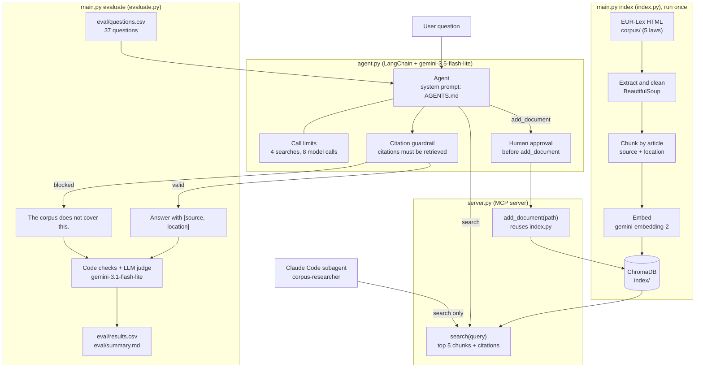

# Assignment 3 Report

- **Name**: Lucas Agustin Vucinovich
- **Student ID**: 18140
- **Group**: BBADBA 5A

## Use case

**Who asks**
- Travellers in the EU whose trip went wrong.
- Customer-service staff who answer them.
- Typical cases: a cancelled flight, a late train, a coach cancelled overnight, a package holiday that changes.

**What they do with the answer**
- Decide whether to claim money, how much, and by when.
- Example: "I'll claim EUR 400 from the airline."

**Wrong answer vs. "I don't know"**
- A wrong answer costs money:
  - told "no" when they are owed EUR 250, the traveller loses EUR 250;
  - told 50% when it is 25%, the claim gets rejected and time is lost.
- "I don't know" only costs a visit to the airline's page or the national enforcement body.
- **So a wrong answer is worse than a refusal.** The system must refuse when the text does not cover the question.

## Corpus

Five EU laws on passenger rights, from EUR-Lex.

| Document (source name) | URL | Date | Licence | Words |
|---|---|---|---|---|
| Regulation (EC) 261/2004, air (`air-261-2004`) | https://eur-lex.europa.eu/legal-content/EN/TXT/HTML/?uri=CELEX:32004R0261 | 11 Feb 2004 | EUR-Lex reuse policy (Decision 2011/833/EU): reuse allowed with source acknowledged | 4,216 |
| Regulation (EU) 2021/782, rail (`rail-2021-782`) | https://eur-lex.europa.eu/legal-content/EN/TXT/HTML/?uri=CELEX:32021R0782 | 29 Apr 2021 | same | 22,822 |
| Regulation (EU) 181/2011, bus and coach (`bus-181-2011`) | https://eur-lex.europa.eu/legal-content/EN/TXT/HTML/?uri=CELEX:32011R0181 | 16 Feb 2011 | same | 7,199 |
| Regulation (EU) 1177/2010, sea (`sea-1177-2010`) | https://eur-lex.europa.eu/legal-content/EN/TXT/HTML/?uri=CELEX:32010R1177 | 24 Nov 2010 | same | 8,490 |
| Directive (EU) 2015/2302, package travel (`package-travel-2015-2302`) | https://eur-lex.europa.eu/legal-content/EN/TXT/HTML/?uri=CELEX:32015L2302 | 25 Nov 2015 | same | 16,477 |
| **Total** | | | | **59,204** |

- Word counts are after cleaning.
- No personal data: these are public laws.
- A sixth law, Regulation 889/2002 (air baggage), is kept apart in `extra_docs/`. I use it to test `add_document`.

## Ingestion

**Extract and clean (`index.py`)**
- BeautifulSoup turns the HTML into lines of text.
- I remove scripts, styles and the EUR-Lex page header.
- I remove the signatures at the end ("Done at…").
- I remove the correlation tables. They are only lists of article numbers.

**Chunking**
- One chunk per article.
- Long articles are split at 350 words.
- Each chunk starts with the article title, e.g. "Article 7: Right to compensation".

**Metadata of each chunk**
- `source`: the law, e.g. `air-261-2004`.
- `location`: e.g. `Article 7`, `Annex I, Article 34`, `Recitals`.
- `locations`: every article the chunk touches.
- `design` and `file_hash`.

**Number of chunks**
- 323 in the chosen design (*article*), about 189 words each.
- 299 in the other design (*fixed*).

**Storage**
- Vectors from `gemini-embedding-2` (768 dimensions).
- Stored in ChromaDB in `index/` (11.6 MB).
- Saved batch by batch. A second run embeds 0 chunks.

**Extraction problem I fixed**
- The sea law writes `Article\xa07` (a non-breaking space, not a normal space).
- So "Article 7" was not recognised as a heading, and its text was labelled with the previous article.
- Fix: normalise all spaces in every line before looking for headings.

**Other problems**
- **Repeated article numbers.** Annex I of the rail law has its own "Article 34". So inside annexes the location is `Annex I, Article 34`.
- **Downloads blocked.** EUR-Lex blocks Python scripts (HTTP 202, empty page). So the HTML files are saved in `corpus/`. The licence allows it.
- **Embedding problem.** The first run gave **1 vector for 50 chunks** (`ValueError: ids: 50, embeddings: 1`). `gemini-embedding-2` reads a plain list of texts as *one* input. Fix: send each chunk as its own `Content`.

## Test set

**How I wrote it**
- 37 questions, written the way a traveller asks.
- Written before comparing the two chunking designs.
- After a review I corrected three reference answers (q13, q15, q18). I also moved q26 and q29 from *multi* to *single*, because one article is enough to answer them.
- Each reference answer is taken from the article text.
- A script checked that every expected article exists in the chunks.

| kind | count |
|---|---|
| single | 25 |
| multi (two passages) | 5 |
| unanswerable | 7 |

**Unanswerable questions** are on topic, but the answer is not in the text:
- lost suitcase on a flight;
- dog in the cabin;
- hand-luggage size;
- court deadline under 261/2004;
- fee for printing a boarding pass;
- airport-tax refund after a no-show;
- UK law after Brexit.

**Two examples**
- **q17 (single):** "My ferry trip was scheduled to take 3 hours but it arrived 2 and a half hours late. What compensation can I ask for?"
  - Answer: 50% of the ticket price. The delay is more than double the 1-hour threshold [sea-1177-2010, Article 19].
- **q28 (multi, two laws):** "If I have to stay overnight because of a cancellation, how many hotel nights must a coach company pay compared with a ferry company?"
  - Answer: both can cap the hotel at EUR 80 a night.
  - Coach: at most 2 nights [bus-181-2011, Article 21].
  - Ferry: at most 3 nights [sea-1177-2010, Article 17].

## Retrieval

**What I measure**
- **Hit@k**: share of the 30 answerable questions where an expected passage is in the top k results.
- **Multi: both in top 5**: for multi questions, are *both* passages found?

**Two designs**
- *fixed*: windows of 200 words, ignoring structure.
- *article*: one chunk per article.

| design | hit@1 | hit@3 | hit@5 | multi: both in top 5 | words added to prompt (top 5) |
|---|---|---|---|---|---|
| fixed | 73% | 87% | 90% | 80% (4/5) | 996 |
| **article** | **77%** | **93%** | **100%** | 80% (4/5) | 1,229 |

**Chosen: article**
- It finds the right passage for every question in the top 5 (100% vs. 90%).
- It costs about 230 more words per prompt. That is cheap.

**Why fixed windows failed**
- They missed q13, q14 and q27 (rank of the first hit per question: `eval/retrieval_per_question.csv`).
- In all three, the answer is a short article mixed with its neighbours in one window.
- Example q13: Annex I, Article 34 is one sentence (1,400 units of account). Other luggage windows ranked higher.
- In the article design, the title at the top of each chunk helps short articles rank.
- Both designs miss one multi question (q27): the article design finds only the first of its two passages.

## Architecture



- **Index stage:** turns the 5 laws into 323 chunks with vectors, saved once in `index/`.
- **MCP server:** the only way to reach the index. It is used by my agent and by the Claude Code subagent.
- **Harness:** the agent decides when to search. Code then checks every citation before the user sees the answer.
- **Evaluation:** runs the agent on every test question, then checks the answers with code and with a second model.

## Tools and subagent

**Tool descriptions (`server.py`)**
- `search(query)`:
  - Searches EU passenger-rights law (air, rail, bus, sea, package travel).
  - Use it for questions about compensation, refunds, re-routing, assistance and complaints.
  - Returns the 5 best passages, each with its citation `[source, location]`.
- `add_document(path)`:
  - Adds an `.html` or `.txt` file to the index.
  - If the same file is already there, it does nothing. If an earlier run stopped half-way, it embeds only the missing chunks.
  - If a file with the same name but new content is there, it replaces it.
  - Returns how many chunks were added.

**One search result** (question q01):
```
[1] [air-261-2004, Article 7] (similarity 0.826)
Article 7: Right to compensation
Right to compensation 1. Where reference is made to this Article, passengers shall receive
compensation amounting to: (a) EUR 250 for all flights of 1500 kilometres or less; (b) EUR 400 ...
```

**Subagent instructions** (`.claude/agents/corpus-researcher.md`, only tool: `search`)
1. Search first, once per part of the question.
2. Answer only from the passages.
3. Cite `[source, location]` after every claim.
4. If not covered, say "The corpus does not cover this."
5. Keep it under about 120 words.

**Transcript from Claude Code** (full version in `eval/subagent_transcript.md`)
> **User:** Use the corpus-researcher subagent to answer: My ferry trip was scheduled to take 3 hours but it arrived 2 and a half hours late. What compensation can I ask for?
> **Subagent → search:** "sea passenger compensation delay in arrival percentage ticket price" → `[sea-1177-2010, Article 18]`, `[sea-1177-2010, Article 19]`, …
> **Subagent → search:** "sea compensation exceptions weather conditions extraordinary circumstances" → `[sea-1177-2010, Recitals]`, `[sea-1177-2010, Article 20]`, …
> **Subagent → main agent:** "**50% of the ticket price.** … Your 2.5-hour delay qualifies for 50% [sea-1177-2010, Article 19]."
> **Final answer of the main Claude Code agent (built from the subagent's reply):** You're entitled to **50% of the ticket price**… a delay of more than double that (more than 2 hours) gives you 50%. Yours was 2.5 hours, so you get 50% [sea-1177-2010, Article 19]… You get nothing if the carrier proves the delay was caused by weather that put the ship's safe operation at risk… [sea-1177-2010, Article 20].

- The subagent got this right.
- My own agent got the same question wrong (see Failures).

## Adding a document

**If the document is already indexed**
- `add_document` compares the file's fingerprint (hash) with the stored one.
- Same file → nothing changes, and it says so.
- Same name, new content → old chunks deleted, new ones stored.
- So there are never two versions of the same law.

**The test**
- Question q31: "An airline lost my checked suitcase on a flight. What is the maximum compensation the airline must pay?"
- Document added: Regulation 889/2002 (air baggage), 9 chunks.
- The test runs on a copy of the index. The committed index stays unchanged.

| Step | Result |
|---|---|
| **Before** | "The corpus does not cover this. The corpus covers rail passenger rights, including luggage rules under train regulations, but does not contain provisions for lost luggage on flights." |
| `add_document` | "Added 'air-liability-889-2002': 9 chunks embedded and stored." |
| Called again | "'air-liability-889-2002' is already indexed (9 chunks). Nothing was changed." |
| **After** | "The air carrier is liable for the destruction, loss, or damage to baggage up to a limit of 1,000 SDRs (Special Drawing Rights) [air-liability-889-2002, Article 1]. Passengers can benefit from a higher liability limit by making a special declaration at the latest at check-in and by paying a supplementary fee [air-liability-889-2002, Article 1]." |

## Harness and guardrails

**AGENTS.md rules** (each has its reason in the file)
1. Search before answering.
2. Answer only from the search results.
3. Cite every claim as `[source, location]`.
4. If not covered, say exactly "The corpus does not cover this."
5. Be short: answer first.
6. Never add documents on its own.

**How the agent works (`agent.py`)**
- LangChain `create_agent` with `gemini-3.5-flash-lite`.
- System prompt: AGENTS.md.
- Tools: `search` and `add_document`, from `server.py` over MCP.

**Approval step**
- `add_document` runs only if a person types `y`.
- With no person at the terminal (check.py, evaluation), the answer is always no.
- Denied example: trace `{'tool': 'add_document', 'approved': False}` → "The document was not added because the action was not approved."
- Approved example (on a copy of the index): 9 chunks added → "The document `air-liability-889-2002` has been successfully added to the index…"

**Call limits**
- At most 4 searches per question.
- At most 8 model calls per question.

**Extra guardrail: citation check**
- After the agent answers, code reads every citation in the answer.
- It checks that each one was really returned by `search`.
- If an answer has no citation, or cites something not retrieved, it is blocked.
- A "refusal" that still gives an amount ("The corpus does not cover this. However, you get EUR 600.") counts as an answer, so it needs valid citations too.
- The user gets "The corpus does not cover this." instead.
- Skipped when `add_document` was used, because "document added" is not a claim about the law.

**When it fired correctly**
- q32 ("Can I take my dog in the cabin?").
- The model's draft was just "5", with no citation.
- It was blocked, and the user got a proper refusal.

**When it fired wrongly (first version)**
- The model sometimes wrote `[air-261-2004, Article 7, Article 5]`.
- My first parser read "Article 7, Article 5" as one location. It did not exist, so the answer was blocked.
- In v1 the guardrail fired 6 times: once correctly (q32) and 5 times wrongly.
- Of those 5 blocked answers, 4 were correct (q01, q13, q20, q28) and 1 was wrong (q25).
- I fixed the parser and re-checked the saved answers in code, with no new model calls.

## Evaluation

**Code checks (`evaluate.py`)**
- Citations valid: every cited passage was retrieved.
- Refusal only when expected: refuse the unanswerable questions, answer the rest.
- Whether the guardrail fired.

**LLM judge**
- Model: `gemini-3.1-flash-lite`, different from the agent's model.
- It sees the question, the reference, the retrieved passages and the answer.

**Judge rubric**
- **correct = 1**: same key fact as the reference (amount, %, deadline or yes/no).
  - A refusal on an answerable question = 0.
  - Any answer to an unanswerable question = 0.
- **supported = 1**: every claim is in the retrieved passages.
  - A refusal counts as supported.

**Results (37 questions)**

| | v1 (first parser) | v2 (final) |
|---|---|---|
| correct | 24 | **28** |
| wrong or unsupported | 1 | **2** |
| wrong refusals | 5 | **0** |
| correct refusals (of 7) | 7 | **7** |
| answered an unanswerable question | 0 | **0** |
| citations valid (code) | 32/37 | **37/37** |
| refusal when expected (code) | 32/37 | **37/37** |
| judge: correct | 31/37 | **35/37** |
| judge: supported | 36/37 | **36/37** |

- From v1 to v2, four wrong refusals became correct answers (q01, q13, q20, q28).
- q25 became a wrong answer: once unblocked, its draft was wrong.

**My grades vs. the judge**
- I graded 20 answers in `eval/human_labels.csv`: 17 answerable (13 single, 4 multi) and 3 unanswerable.
- I used `eval/grading_sheet.csv`, which hides the judge's grades.
- **My first grades:** all 20 correct and supported.
  - Agreement with the judge: 18/20 on `correct` (90%) and 19/20 on `supported` (95%).
- **After Claude's correction** (see AI use), two grades changed:
  - **q17:** said 25% instead of 50%. Correct = 0. Supported = 1: the 25% is in the text.
  - **q25:** said EUR 125 instead of EUR 250. Correct = 0. Supported = 0: it invents a "2 to 4 hours" rule.
  - Agreement with the judge: 20/20 on both (100%). This is the number in `eval/summary.md`.
- So the 100% is not a fully independent check. The two corrected grades are exactly the two answers the judge marked wrong.
- The honest figure for my own first reading is 90%.
- Why the agreement is so high: most answers are clear-cut, either a number or a refusal.
- Grey cases: q18, q22, q26 and q29 leave out a minor detail. I graded them correct because the key fact is right.

## Failures

**Failures by cause (final run)**

| cause | count | questions |
|---|---|---|
| retrieval miss | 0 | – |
| wrong answer from the right passage | 2 | q17, q25 |
| unsupported claim | 0 | – |
| wrong refusal | 0 (5 in v1, caused by my parser) | v1: q01, q13, q20, q25, q28 |
| bad test question | 0 | – |

**The two failures**
- **q17 (ferry):** it had Article 19 but said 25%. It missed the rule "more than double the delay → 50%".
- **q25 (air):** it said EUR 125. The 50% cut only applies if the new flight arrives within 2 hours. Here it was 3 hours.

**What they have in common**
- Both are rules with two thresholds, applied to the numbers in the question.
- The right article was found both times. Retrieval is not the problem.

**What to fix first**
- The reasoning on threshold rules.
- Option 1: a larger model. Claude's subagent answered q17 correctly from Article 19.
  - This is only one question, and the subagent searched twice. It is a hint, not a fair comparison.
- Option 2: a new AGENTS.md rule: "check the user's numbers against each threshold before answering".

## Decision

**Would I let users rely on it?**
- **Yes, as a help-desk assistant**, for people who check the cited article.
- **No, as a final legal answer.**

**Why**
- It never answered an unanswerable question (7/7 refusals).
- Every citation was real (37/37).
- 28 of 30 answerable questions were right.
- My final grades agree with the judge on all 20 answers I graded. With my first grades it was 90% (see Evaluation).
- But the 2 errors gave a wrong amount. That is the costly kind of mistake.

**Safeguard**
- Always show the cited article next to the answer.
- Add a "check the article" note when the amount depends on distance or delay length.

**Cost and speed per question**
- 3,809 tokens on average.
- 12.3 seconds on average (1–3 searches).
- 0 € on the Gemini free tier.
- The free tier was the real limit:
  - `gemini-2.5-flash` was not available for my new key;
  - `gemini-3.5-flash` returned a daily quota error (429) after about 20 requests.
- That is why the agent uses flash-lite.

## AI use

- Proposed the corpus and the use case idea.
- Wrote the first version of:
  - the 37 test questions;
  - the judge rubric;
- Reviewed the work with several agents. The review founded bugs in the code and grammar errors in the report.
- Help if the creation of the diagrame.