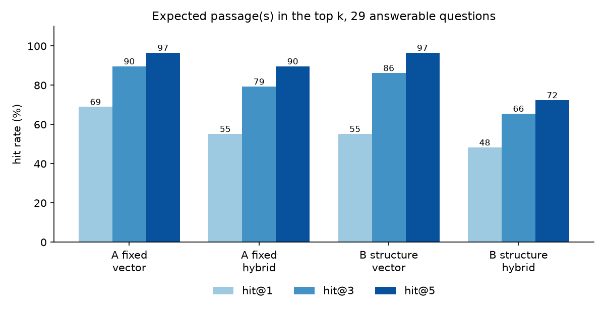

# Assignment 3 Report

- **Name**: Leopoldo Sirolli
- **Student ID**: 19170
- **Group**: BBADBA 5th - A


## Use case

*Who asks, what they do with the answer, and what a wrong answer costs compared with "I don't know".*

The use case for this project could be any financial institution, both an advisor doing research or advisory work for a client or a corporate client himself who wants to conduct this work internally.

Decisions made revolve around whether the deal needs an EU notification, how long clearance could take, whether they can close before clearance, and which competition questions the Commission is likely to ask.

The cost of a wrong answer is a missed or late notification, or closing before clearance (gun-jumping), can be fined up to 10% of aggregate turnover (EUMR Article 14(2)); a wrong timetable misprices the deal. "I don't know" only costs a lookup or a call to counsel. So a confident wrong answer is far worse than a refusal.

## Corpus

*Table: document, URL, date, licence, words.*

| Document (id in metadata) | URL | Date | Licence | Words |
|---|---|---|---|---|
| Council Regulation (EC) No 139/2004, EU Merger Regulation (`EUMR`) | https://eur-lex.europa.eu/legal-content/EN/TXT/HTML/?uri=CELEX:32004R0139 | 20 Jan 2004 | EUR-Lex, reuse authorised (Commission Decision 2011/833/EU) | 14,575 |
| Commission Consolidated Jurisdictional Notice (`JURISDICTIONAL_NOTICE`) | https://eur-lex.europa.eu/legal-content/EN/TXT/HTML/?uri=CELEX:52008XC0416(08) | 16 Apr 2008 | same | 24,649 |
| Guidelines on the assessment of horizontal mergers (`HORIZONTAL_GUIDELINES`) | https://eur-lex.europa.eu/legal-content/EN/TXT/HTML/?uri=CELEX:52004XC0205(02) | 5 Feb 2004 | same | 8,602 |
| Guidelines on the assessment of non-horizontal mergers (`NONHORIZONTAL_GUIDELINES`) | https://eur-lex.europa.eu/legal-content/EN/TXT/HTML/?uri=CELEX:52008XC1018(03) | 18 Oct 2008 | same | 9,265 |
| **Total** | | | | **57,091** |

Added later through `add_document`: Commission Notice on a simplified treatment for certain concentrations (`SIMPLIFIED_NOTICE`), https://eur-lex.europa.eu/legal-content/EN/TXT/HTML/?uri=CELEX:52023XC0505(01), 5 May 2023, same licence, 20 chunks.

All are official EU legal texts with no personal data. The texts are fetched from the Publications Office (Cellar) endpoint, because EUR-Lex answers scripts with an empty anti-bot page (HTTP 202, 0 bytes).

## Ingestion

*How you extract, clean and chunk; one extraction problem you fixed; chunk metadata; number of chunks.*

- **Extract:** EUR-Lex XHTML parsed with BeautifulSoup (PDF and text also supported for `add_document`). Footnote reference tags and footnote blocks are removed before text extraction; two-cell table rows (`(a)` | text) are joined into one line.
- **Clean:** whitespace normalised, page furniture and footnote lines dropped.
- **Structure:** each document is cut into units: `Recital N` and `Article N` (with the article title) in the Regulation, numbered `para N` in the notices and guidelines, each with the nearest section heading. Paragraph numbers must run in sequence (n+1), so list items are not mistaken for paragraphs.
- **Extraction problems fixed:**
  1. Footnote numbers glued to words ("Commission(1)", "undertakings(4)"): stripped only when the bracket follows a letter, so legal references like "Article 4(1)" survive.
  2. The Horizontal Guidelines end with their footnote list as plain text: "para 91" swallowed ~80 footnotes (2,332 words) and footnotes 92 to 97 became fake paragraphs. Fix: numbering restarting at "(1)" after the real paragraphs marks the footnote list and ends parsing. Para 91 dropped to 239 words, the document to 8,602 words.
- **Chunk metadata:** `source` (document id), `location` (e.g. `Article 7`, `paras 124-126`, `Article 4 (part 2)`), `units` (every article/recital/paragraph the chunk covers), `section`, `added` (true for documents added later).
- **Chunks:** 286 (fixed design) and 266 (structure design); 552 vectors, `gemini-embedding-2` at 768 dimensions, index/ 17 MB. Every vector is appended to `index/vectors.jsonl` as it arrives, keyed by a hash of the text, so re-runs only embed new or changed chunks.
- **Cost note:** the binding free-tier limit was 30,000 embedding tokens per minute, not 1,000 texts per day; batches of 50 structure chunks never fit in one minute, batches of 20 do.

## Test set

*How you wrote it, counts by kind, two examples.*

The test set was created by coming up with 34 questions, and following the guidelines 22 were single, 6 multi and 6 unanswerable, all were obviosuly spread over the 4 documents and phrased in a manner I would imagine a M&A advisoory team would
The 6 unanswerable questions are the most important part of this test set: they check that the assistant refuses when the corpus does not cover a question, instead of giving a confident answer that could mean a missed filing and a fine of up to 10% of turnover (see Use case).

All 6 refusals were correct. On q31 and q34 the judge disagreed with my labels: it marked the refusals wrong because they named the closest passages, which AGENTS.md allows, so I graded them correct.

Two examples:

| id | kind | question | expected | reference answer |
|---|---|---|---|---|
| q11 | single | We are forming a JV just to build a wind farm, which it will hand over once it is built. Is that a notifiable concentration? | JURISDICTIONAL_NOTICE, para 104 | No, a JV set up for a short finite project such as building a plant does not operate on a lasting basis. |
| q24 | multi | If we close a notifiable deal before Commission clearance, what is our legal exposure? | EUMR, Article 7 ; Article 14 | Closing early breaches the standstill obligation, which can be fined up to 10% of aggregate turnover. |

## Retrieval

*Hit rate at 1/3/5 per design, words added to the prompt, the design you chose.*

Hit = every expected passage is in the top k (answerable questions only, n = 28). Words = average words of the top 5 chunks added to the prompt.

| Design | hit@1 | hit@3 | hit@5 | words@5 |
|---|---|---|---|---|
| A. Fixed 250-word windows, 50 overlap | **0.46** | 0.68 | 0.82 | 1,247 |
| B. Structure: article/paragraph units, packed to ~300 words, section header embedded | 0.39 | **0.79** | **0.86** | **1,162** |
| C. B + BM25 keyword search, fused with reciprocal rank fusion | 0.32 | 0.64 | 0.71 | 1,206 |



After evaluating A (fixed), B (structure) and C (Hybrid) I opted to work with B. 

Evidence: the agent receives k = 5, where B is best (0.86); B is clearly best at k = 3 (0.79 vs 0.68); 

k=5 is the setting that matters because agetn alwyas gets 5 passages, B is better but only by one question, the real difference comes at k=3.

At k=3 B is the clear winner by 3 questions (22 vs 19). B also puts the right passage towards to top so its more robust even by reducing K.

A wins at k=1  (13 vs 11), only two question and in all fairness the agent never uses k=1, so it doesn't affect my choice here-

Moreover this is also slightly cheaprer by around 100 prompt words and this results in less noise for the model, yes it is a minor point but still worth taking into account. 

C lowers every number the legal vocab is repeated almost in all passages so word matching just adds noise. 

## Tools and subagent

*Your tools' descriptions, one search result, the subagent's instructions, one transcript from your editor.*

**`search(query)`**: description the model reads:
> Search the EU merger control corpus: the EU Merger Regulation (Regulation 139/2004), the Commission Consolidated Jurisdictional Notice, and the horizontal and non-horizontal merger assessment guidelines, plus any document added later. Use it for any question about EU merger control: what counts as a concentration, control and joint ventures, turnover thresholds and how turnover is calculated, notification, deadlines and procedure, referrals, and how the Commission assesses competitive effects. Write the query in plain English with the key legal terms. Call it again with a different query if the first results do not cover the question. Returns the 5 most relevant passages, each with its source document id and location (article, recital or paragraph) and a ready-made citation such as [EUMR, Article 1].

**`add_document(path)`**:
> Add one document (.html, .pdf, .txt or .md file on this machine) to the corpus index. The file goes through the same pipeline as the corpus: text extraction, cleaning, chunking by article/paragraph, Gemini embedding, storage in index/. The document id is the file name in capitals (e.g. simplified_notice.html -> SIMPLIFIED_NOTICE). If the same file is already indexed, nothing is embedded or changed. If a file with the same id but different content is added, it replaces the old version. Returns the status (added, replaced or already_indexed), the document id and the number of chunks stored.

One search result (from `check.py`, query = q01):
```
[1] source: EUMR | location: Article 1
cite as: [EUMR, Article 1]
1. Without prejudice to Article 4(5) and Article 22, this Regulation shall apply to all concentrations with a Community dimension as defined in this Article.
2. A concentration has a Community dimension where:
(a) the combined aggregate worldwide turnover of all the undertakings concerned is more than EUR 5000 million; and ...
```

**Subagent** (`.claude/agents/corpus-researcher.md`, tool: `mcp__corpus__search` only):
> Search with the key legal terms of the question. If the results do not cover every part, search again with different wording (at most 4 searches). Answer in at most 6 sentences, using only what the returned passages say. Do not use your own knowledge of EU law. Put a citation after every claim exactly as the result labels it. Quote thresholds, amounts and deadlines exactly. If the passages do not answer the question, reply `The corpus does not cover this question.` and, in one line, what the closest passages were about.

**Transcript** (VS Code 1.143, GitHub Copilot Chat, Agent mode, `corpus` MCP server from `.vscode/mcp.json`; each tool call needed an explicit "Allow"):

> **User:** Use the corpus-researcher subagent to answer: can we close an EU-notifiable deal before the Commission clears it?
>
> *corpus-researcher* → **Run `search`** (corpus MCP server) `{"query": "Can parties close ..."}` → allowed
>
> *corpus-researcher* → **Run `search`** (corpus MCP server) `{"query": "suspension obligation ..."}` → allowed
>
> *Completed 6 steps in 25s*
>
> **Answer:** No. The implementation of an EU-notifiable concentration must be suspended until the Commission takes a final decision. A derogation may be requested, but only if the Commission grants one after considering the relevant factors. [EUMR, Recitals 33-34]

The agent reached the right conclusion searching twice with diffrerent wording and stayed within the passages.

On the other hand it cited recitals 33-34 instead os article 7, they explain why rule exists, the article explains the rule itself. 

A fix here could be telling the agent to just choose articles unless told so.

## Adding a document

*What happens when a document is already indexed. The unanswerable question, the document you added, the answer before and after.*

- **Already indexed:** same document id and same file hash: nothing is embedded or changed, returns `already_indexed`. Same id, different content: treated as a new version, old chunks removed, new ones stored (`replaced`). 

Re-adding the same file does nothing, so duplicate chunks never push other passages out of the top 5; a changed file replaces the old one, so the agent never cites outdated legal text after an update.

- **Unanswerable question q29:** "Our deal is a joint venture with no activities in the EEA. Does it qualify for the simplified procedure and a short-form CO filing?"
- **Document added:** Commission Notice on a simplified treatment for certain concentrations (2023), 20 chunks.
- **Before:** "The corpus does not cover this question (it does not contain the rules on the simplified procedure or the short-form CO filing). The search results only cover the jurisdictional concepts of joint ventures, joint control, and full-functionality under the Jurisdictional Notice."
- **After:** "Yes, a joint venture with no activities in the EEA qualifies for the simplified procedure [SIMPLIFIED_NOTICE, para 5(a)]. ... provided that the joint venture has no current or expected turnover within the territory of the EEA, and the undertakings concerned have not planned to transfer any assets within the EEA to the joint venture at the time of notification [SIMPLIFIED_NOTICE, para 5(a)]. Eligible concentrations of this type are notified by completing the relevant sections of the Short Form CO [SIMPLIFIED_NOTICE, para 26]."

The evaluation keeps the test set reproducible: added documents are excluded when answering the 34 questions (`CORPUS_EXCLUDE_ADDED=1`), so q29 stays unanswerable there.

## Harness and guardrails

*Your AGENTS.md rules, the approval step, and your extra guardrail with one case where it fired.*

**AGENTS.md rules** (system prompt), each with its reason in the file: search before every answer; answer only from search results; cite every claim as `[SOURCE, location]`; refuse with the exact sentence `The corpus does not cover this question.`; answer the covered part of partial questions; quote thresholds and deadlines exactly; be short, no legal advice; call `add_document` only when the user asks. 

After reviewing the rules, I would leave most of them unchanged and only revise rule 7, to: have a direct answer first, then the supporting points. State the conclusion in the same terms the cited passage uses, and make sure it does not contradict that passage. No legal advice beyond what the texts say.

**Approval step:** `add_document` is wrapped: before it runs, the harness prints the path and asks `Approve? [y/N]`; anything but "y" returns "Not run: the user did not approve" to the model. With no terminal (evaluation, check.py) it is refused unless `AGENT_AUTO_APPROVE=1`.

**Call limits:** at most 6 tool calls and 8 model calls per question (LangChain `ToolCallLimitMiddleware`, `ModelCallLimitMiddleware`).

**Extra guardrail, citation check:** every `[SOURCE, location]` in the answer must point at a passage the search tool returned in this run, and an answer that is not a refusal must cite something. On failure, the model gets one rewrite with the list of bad citations; if it fails again, the answer is replaced by the refusal.

**A case where it fired (check.py run):** the agent wrote `[EUMR, Article 1; JURISDICTIONAL_NOTICE, para 125]`, two sources in one bracket. The guardrail rejected it, the model rewrote it as separate valid citations, and the final answer passed.

In the first evaluation run the checker was too strict: it read "paras 92, 104" as the range 92 to 104 and required co-cited paragraphs to sit in the same chunk. It fired on 7 answers; 6 were fixed on retry, but on q28 it threw away a correct answer (a wrong refusal caused by the guardrail itself). Fixed by parsing lists and ranges and accepting a paragraph covered by any returned passage; q28 was re-answered.


## Evaluation

*Code checks, the judge's rubric, your agreement with the judge, and results: correct, unsupported, correct refusals, wrong refusals.*

**Code checks** (`eval/results.csv`): refusal (answer opens with the refusal sentence), number of citations, citation validity against the passages returned in that run, correct refusal on unanswerable, wrong refusal on answerable, whether the agent's own searches retrieved the expected passage, guardrail events.

**Judge:** `gemini-3.1-flash-lite` (all 34 answers; a different model from the agent, `gemini-3.5-flash-lite`, to avoid grading its own style), temperature 0, JSON output, given the question, reference answer, question type, retrieved passages and answer. Rubric (`eval/rubric.md`): **correct** = same key facts as the reference (wording free, extra true detail fine; multi needs every part; unanswerable needs a refusal with no substantive answer); **supported** = every claim is in the retrieved passages, judged against the passages, not the judge's own knowledge.

**Results** (34 questions):

| | count |
|---|---|
| Answerable: correct and supported | **27 / 28** |
| Unsupported answers | 0 |
| Wrong refusals | 0 |
| Unanswerable: correct refusals | **6 / 6** |
| Answered an unanswerable question | 0 |
| Answers with a citation the code check rejects | 3 (q06, q08, q27, format only: two sources in one bracket, or sub-paragraphs cited as "Article 9, paras 1-2") |

**Agreement with my labels** (34 graded, `eval/human_labels.csv`):

| | agreement | Cohen's kappa |
|---|---|---|
| correct | 0.88 (30/34) | -0.05 |
| supported | 1.00 (34/34) | 1.00 |


The judge and I agreed on 30 of 34 answers (88%), but this is less impressive than it sounds: we both marked almost every answer correct, so we would agree most of the time even by chance. Kappa, which measures agreement beyond chance, is about -0.05, meaning the judge did no better than a grader that marks everything correct.
The four disagreements show where it fails. On q27, q31 and q34 it was stricter than me, but only on form: it penalised a less concise answer and two refusals that named the closest passages, which AGENTS.md allows. On q09 it was more lenient and accepted a confident "No" that contradicted the passage it cited, which is the most dangerous kind of error for this use case. So the judge cannot be trusted on its own, and a human still needs to check yes/no answers against the cited passage.


## Failures

*Failed questions by cause, with counts, and what to fix first.*

| Cause | Count | Questions |
|---|---|---|
| Retrieval miss | 0 | No failure was caused by retrieval, but on q23, q25 and q28 (multi) the agent's searches missed one of the two expected passages; the answers were still graded correct |
| Wrong answer from the right passage | 1 | q09: cites the right paragraph (para 54) but concludes "No" when the passage means "Yes, negative sole control". The judge also flagged q27; I graded it correct |
| Unsupported claim | 0 | |
| Wrong refusal | 0 | In the first run, q28 was refused by the over-strict citation guardrail; fixed and re-answered |
| Bad test question | 0 | |

Also: 3 answers with malformed citations (format, not fabrication).

I would fix q09-type errors first: a confident yes/no that contradicts the passage it cites is the most dangerous failure, because it looks trustworthy and can lead directly to a wrong filing decision. I would combine two safeguards. First, a new rule in AGENTS.md: for a yes/no question, the model must quote the decisive sentence from the passage before giving its conclusion, so the answer is reasoned from the text rather than stated up front. This is free and easy to add, but it still depends on the model following the rule. Second, the tool would flag every yes/no answer with a prompt to verify it against the cited provision before relying on it. 
ide


## Decision

*Would you let users rely on it, for what, with which safeguard? Cost and latency per question.*

I would let deal teams rely on the assistant for a first check at the start of a transaction, but not for the final filing decision. At that stage it helps find the right article or paragraph quickly, gives thresholds and deadlines with a citation, and shows which questions to take to counsel. The final call on whether and when to notify stays with a lawyer. The results justify trust up to that point: 27 of 28 answerable questions were correct and supported, all 6 unanswerable questions were correctly refused, and no answer contained an unsupported claim. Most importantly for this use case, it says the corpus does not cover a question instead of inventing an answer, and every claim carries a citation a person can open and check. There are three reasons not to go further. On q09 it gave a confident wrong yes/no with a correct citation, and the AI judge did not catch it; only my own grading did. The test set is small (34 questions, one run), so 27 of 28 could look different on a larger test. And the corpus dates from 2004 to 2008, plus one 2023 notice, so later rules and case law, such as the Illumina/Grail referral policy, are missing and some answers may be out of date. The safeguard is the one described under Failures: every yes/no answer is flagged for a person to check against the cited provision before anyone relies on it, while questions outside the corpus continue to be refused.

**Cost and latency per question:** about 6,700 input and 330 output tokens; 8.1 s on average (max 22 s); about 1 to 3 searches. Embedding the corpus once: 552 chunks.

## AI use

*What you used and how, or "none".*

- Claude (Anthropic) wrote most of the code (index.py, retrieval.py, server.py, agent.py, evaluate.py), the first drafts of AGENTS.md, the judge rubric and the subagent instructions

My decisions: use case and corpus, the questions and reference answers, the chunking design choice, the behaviour for re-added documents, my 34 grades, the analysis and the ship decision.

Models used at run time: `gemini-embedding-2` (embeddings), `gemini-3.5-flash-lite` (agent), `gemini-3.1-flash-lite` (judge).
